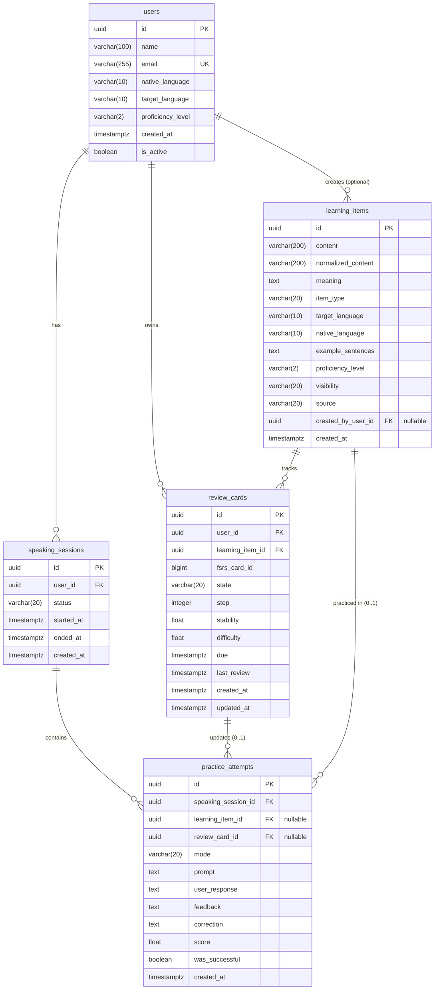

# Database Architecture — Recall Talk

This document outlines the relational database schema of the application, which combines spaced repetition tracking via the **FSRS algorithm (`py-fsrs`)** with AI-driven interactive conversation sessions and performance evaluations.

---

## 1. Entity-Relationship Diagram (ERD)

> **Note:** A static rendering of this diagram is also available at [`database_diagram.png`](./database_diagram.png).

---

## 2. Design Decisions & Data Integrity

1. **Flexibility in `practice_attempts`**:
   - `learning_item_id` and `review_card_id` are optional (`NULLABLE`). This design allows a practice attempt to represent either a **targeted practice session** (bound to specific pre-existing vocabulary/grammar and an FSRS review card) or an unconstrained **free conversation** interaction (where the user practices dialogue with the AI without a registered learning item).
2. **Normalization in `practice_attempts`**:
   - There is no direct `user_id` foreign key on `practice_attempts`. Every attempt strictly belongs to a `speaking_session`, which in turn belongs to a `user`. This avoids redundant data and prevents data anomalies where an attempt could reference a user different from the session owner.
3. **FSRS Deck Integrity (`review_cards`)**:
   - `UNIQUE (user_id, learning_item_id)`: Prevents a user from having duplicate review cards tracking the exact same learning content.
   - `UNIQUE (user_id, fsrs_card_id)`: The `fsrs_card_id` (generated as a millisecond epoch timestamp by `py-fsrs`) is scoped uniquely per user, preventing collisions in concurrent multi-user environments.
4. **Content Storage (`learning_items`)**:
   - The `example_sentences` field is stored as a `TEXT` column, providing lightweight storage and broad compatibility across database engines.

---

## 3. Enums Dictionary

| Enum | Allowed Values | Description |
|---|---|---|
| `ProficiencyLevel` | `A1`, `A2`, `B1`, `B2`, `C1`, `C2` | Common European Framework of Reference for Languages (CEFR) levels. |
| `ItemType` | `WORD`, `EXPRESSION`, `GRAMMAR` | Category of the linguistic item being studied. |
| `LearningItemVisibility` | `PERSONAL`, `SHARED` | Indicates whether the item is private to the creator or shared globally. |
| `LearningItemSource` | `USER_CREATED`, `AGENT_SUGGESTED` | Content origin (manually registered by a user or suggested by an AI agent). |
| `SpeakingSessionStatus` | `ACTIVE`, `COMPLETED`, `ABANDONED` | Lifecycle status of a user's speaking practice session. |
| `PracticeMode` | `TARGETED`, `FREE_CONVERSATION` | Mode of the attempt (focused practice vs. free conversation). |
| `FSRSState` | `Learning`, `Review`, `Relearning` | Memory state of the card managed by the FSRS algorithm. |
